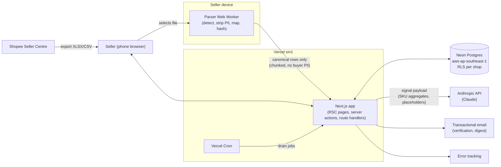
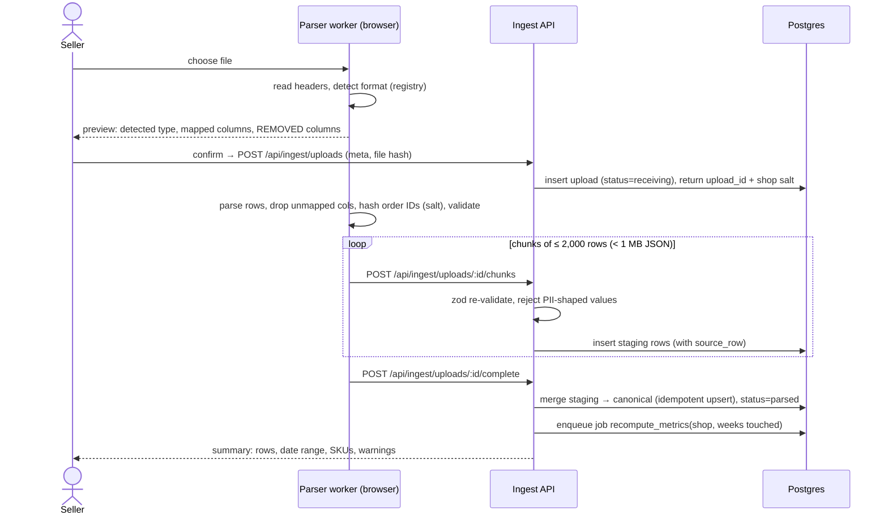

# 01 — Architecture

The system is one Next.js app deployed to Vercel's Singapore region (`sin1`), backed by one Neon Postgres database in `aws-ap-southeast-1`. Heavy parsing runs in the seller's browser. Scheduled work runs as jobs in a Postgres table, drained by Vercel Cron. Claude is the only external AI service, and it only sees SKU-level aggregates.

## Context



The privacy boundary is the device edge. Only canonical rows cross it: mapped columns, with order IDs hashed and buyer columns already dropped. The only data that crosses the Claude boundary is SKU-level aggregates in a fixed payload schema (see [06](06-llm-integration.md)).

## Components

| Component | Runs where | Responsibility | Package |
| --- | --- | --- | --- |
| Web UI | Browser + Vercel (RSC) | Vietnamese, phone-first pages: onboarding, upload, costs, profit, actions, competitors, settings | `apps/web` |
| Parser worker | Browser Web Worker (also Node for re-parse) | Format detection, PII strip, column mapping, validation, order-ID hashing | `packages/parsers` |
| Ingest API | Vercel function | Receive row chunks, re-validate with zod, write staging → canonical, record provenance | `apps/web/app/api/ingest` |
| Domain services | Vercel function | Costs, competitors, recommendations lifecycle, DSR, consent | `apps/web/server/*` |
| Metrics + rules engine | Vercel function (job) | Weekly SKU metrics, rule evaluation, scoring, outcome measurement; pure functions | `packages/engine` |
| LLM adapter | Vercel function (job / request) | Build payload, call Claude, validate placeholders, render text, log cost | `packages/llm` |
| Data access | Vercel function | Drizzle schema, migrations, RLS SQL, `withShopContext()` transaction helper, repositories | `packages/db` |
| Shared | Everywhere | Types, zod schemas, money/date formatting, ISO week helpers | `packages/shared` |
| Job runner | Vercel function triggered by Cron | Claim due jobs with `FOR UPDATE SKIP LOCKED`, run handlers, retry with backoff | `apps/web/app/api/cron/*` + `packages/db/jobs` |

## Repository layout

```
apps/
  web/                    Next.js App Router
    app/(marketing)/      public pages, terms, privacy (vi first)
    app/(app)/            authenticated app: /upload /costs /profit /actions /competitors /settings
    app/api/ingest/       chunked row ingest
    app/api/cron/         job drainer, weekly scheduler, retention purge
    server/               domain services (server-only)
    messages/vi.json      UI strings
packages/
  db/                     drizzle schema, migrations, rls.sql, repositories, jobs
  parsers/                format registry, versioned parsers, PII rules, fixtures, synthetic generator
  engine/                 metrics, rules, scoring, outcomes, golden set
  llm/                    LlmClient, Claude adapter, prompts, schemas, placeholder validator
  shared/                 types, zod, format (VND, dates), week helpers
docs/                     this pack
```

Dependency direction: `apps/web` → `engine`, `llm`, `parsers`, `db` → `shared`. `engine` has no I/O, so it takes data in and returns results, and runs the same in tests, jobs and the what-if simulator (FR-14). `parsers` has no Node-only or DOM-only imports outside two thin entry points (`browser.ts`, `node.ts`).

## Key flows

### F1 — Upload an export (FR-03, FR-04, US-02)



Chunking exists because Vercel functions cap request bodies at 4.5 MB, and it also lets the progress bar move on slow 4G.

### F2 — Weekly run (FR-06, FR-07, US-05)

1. Vercel Cron fires `schedule_weekly` at 00:05 Monday ICT (Sunday 17:05 UTC).
2. The scheduler enqueues one `weekly_run(shop_id, iso_week)` job per active shop.
3. The drainer claims jobs. Each job runs inside `withShopContext(shop_id)` so that RLS still applies.
4. `engine.computeWeekMetrics` → `engine.evaluateRules` → `engine.rank` → top 5 candidates.
5. `llm.explain(candidates)` makes one Claude call per shop per run, then validates placeholders and renders text. Failures fall back to the deterministic Vietnamese templates.
6. The job persists `recommendation_run` + `recommendation` rows and enqueues `email_digest` (FR-15, Should).

The "on demand" run (FR-07) is the same job, enqueued by a button press, rate-limited to 3 per shop per day.

### F3 — Decide and measure (FR-09, US-06)

The seller accepts, dismisses (with a reason) or marks done. Marking done stamps `done_at`. A daily `measure_outcomes` job finds recommendations at +7 and +14 days, computes the deltas against the baseline (see [05](05-recommendation-engine.md#outcome-measurement)), writes `outcome` rows, and updates the rule track record.

### F4 — Data-subject requests (FR-11, US-08)

Export streams a ZIP of CSVs straight from an owner-only route handler. It is generated on request and never stored, which keeps object storage out of the design (ADR-003). At MVP volume (≤ 50k lines a quarter) this fits inside one function invocation. Delete acknowledges at once, soft-locks the account, and a `hard_delete_account` job runs after a 7-day undo window. That stays well inside the 20-day statutory limit. See [03](03-security-privacy.md#data-subject-requests).

## Runtime choices

| Concern | Choice | Why |
| --- | --- | --- |
| Rendering | React Server Components for reads; server actions for mutations | Fewer client bundles on low-end phones |
| DB driver | `@neondatabase/serverless` Pool (WebSocket) via Drizzle | Interactive transactions are needed for `SET LOCAL` RLS context; the HTTP driver can't hold one |
| Validation | zod schemas in `packages/shared`, used by both client and server | One contract for parser output and API input |
| i18n | `next-intl`, `vi` default, `en` for internal/admin | NFR-L10N |
| Charts | Lightweight SVG components (no heavy chart lib on mobile) | NFR-PERF |
| Testing | Vitest (unit), PGlite in-process Postgres (integration + RLS), a Neon branch job before beta, Playwright (e2e, mobile viewport) | NFR-MAINT |

## Performance budget (NFR-PERF)

| Path | Budget | How |
| --- | --- | --- |
| Profit view, 50k order lines/quarter | p95 < 2 s on 4G | Read from the precomputed `sku_week_metric` (≈ 300 SKUs × 13 weeks ≈ 4k rows), never from raw order lines at request time |
| 20 MB export parsed | < 30 s | Web Worker, streaming CSV parser, XLSX read once; chunks uploaded in parallel (2 in flight) |
| Weekly run per shop | < 20 s | Set-based SQL for metrics; one LLM call |
| JS on first load of `/actions` | < 170 KB gzipped | RSC; parser worker loaded only on `/upload` |

## Phase 2 hook: Open Platform adapter

`packages/parsers` exports a `SourceAdapter` interface: `toCanonical(raw) → CanonicalBatch`. The Open Platform sync (FR-16) is a second adapter that runs server-side, maps API responses into the same `CanonicalBatch`, and goes through the same ingest merge. It must apply the same PII allowlist, because the Open Platform Data Protection Policy's 90-day cap never applies if we never store buyer data.
