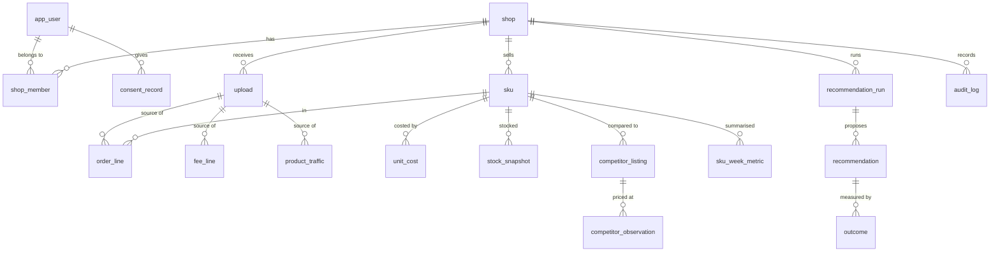

# 02 — Data model and row-level security

One canonical, platform-agnostic schema in Postgres. Every tenant table carries `shop_id` and is protected by RLS policies keyed on a per-transaction session setting. The app and the job worker connect as roles that cannot bypass RLS. Money is stored as `bigint` VND.

## Entity overview



## Conventions

| Topic | Rule |
| --- | --- |
| Keys | `uuid` primary keys, `gen_random_uuid()` |
| Tenant column | `shop_id uuid not null` on every tenant table, first column of most indexes, with a foreign key to `app.shop` `on delete cascade`, so deleting a shop removes all its data (US-08) |
| Money | `bigint` VND, column suffix `_vnd`. Never `numeric` floats in app code; `bigint` maps to JS `bigint` |
| Percentages | `numeric(7,4)` as fractions (0.1500 = 15%) |
| Time | `timestamptz` for events; `date` for business days in `Asia/Ho_Chi_Minh`; `iso_week text` as `2026-W45` |
| Provenance | Fact rows carry `upload_id` + `source_row int` (FR-08, US-04 "every number links to its source rows") |
| Soft delete | None on facts. Account deletion is a hard delete (US-08) |
| Audit | Append-only `audit_log`; no `update`/`delete` grants |

## Tables

Auth tables (`user`, `session`, `account`, `verification`, `two_factor`, `rate_limit`) follow Better Auth's model (ADR-007) and live in schema `auth` (migration 0004). Only the `sa_auth` role can touch them (migration 0005); the connecting role holds `sa_auth`, so Better Auth works, but once `withContext` switches to `sa_app` or `sa_worker` the auth tables are out of reach. A tenant-query bug therefore cannot read session tokens or password hashes. Everything below lives in schema `app`.

### Identity, tenancy, consent

```sql
create table app.shop (
  id uuid primary key default gen_random_uuid(),
  name text not null,
  platform text not null default 'shopee' check (platform in ('shopee','tiktok','lazada')),
  category text,                         -- seller-chosen, drives default thresholds
  is_demo boolean not null default false,-- FR-12
  order_hash_salt bytea not null,        -- per-shop salt for order-ID hashing (see 04)
  settings jsonb not null default '{}',  -- target_margin, price_gap_threshold, lead_time_days default
  created_at timestamptz not null default now()
);

create table app.shop_member (
  shop_id uuid not null references app.shop(id) on delete cascade,
  user_id text not null,                 -- auth.user.id
  role text not null check (role in ('owner','staff')),
  primary key (shop_id, user_id)
);

create table app.consent_record (        -- FR-02, US-01; append-only
  id uuid primary key default gen_random_uuid(),
  user_id text not null,
  purpose text not null check (purpose in ('service_processing','anonymised_benchmarking','marketing')),
  granted boolean not null,
  policy_version text not null,
  ui_text_hash text not null,            -- hash of the exact consent wording shown
  user_agent text,
  created_at timestamptz not null default now()
);
```

The current consent per purpose is the latest row per `(user_id, purpose)`. A withdrawal is a new row with `granted = false`. Rows are never updated.

### Ingestion

```sql
create table app.upload (
  id uuid primary key default gen_random_uuid(),
  shop_id uuid not null references app.shop(id) on delete cascade,
  uploaded_by text not null,
  export_type text not null,             -- e.g. 'shopee.orders', 'shopee.product_performance'
  parser_id text not null,               -- e.g. 'shopee.orders@v1'
  file_sha256 text not null,             -- of the original file, computed in browser; dedupe
  file_name text not null,
  removed_columns jsonb not null,        -- headers dropped in browser, shown to seller (FR-04)
  row_count int,
  period_from date, period_to date,
  status text not null check (status in ('receiving','parsed','failed','superseded')),
  warnings jsonb not null default '[]',
  created_at timestamptz not null default now(),
  parsed_at timestamptz,
  unique (shop_id, file_sha256)
);
```

```sql
create table app.ingest_stage (          -- chunk landing zone; emptied when the upload completes or fails
  upload_id uuid not null references app.upload(id) on delete cascade,
  shop_id uuid not null,
  record_kind text not null,             -- 'order_line' | 'fee_line' | 'product_traffic' | 'sku' | 'stock'
  source_row int not null,
  record jsonb not null,                 -- canonical shape, already zod-validated
  primary key (upload_id, record_kind, source_row)
);
```

Re-sent chunks are idempotent because of the primary key. On `complete`, one transaction merges the staged rows into the canonical tables. A re-upload of the same period marks the older overlapping upload `superseded` and replaces its rows, then deletes the stage rows. Stale `receiving` uploads older than 24 hours are failed and purged by the retention job.

No raw or stripped file bytes are stored. The browser re-parses if the seller re-uploads, and fixtures in `packages/parsers` cover regressions. This exceeds the discovery pack's "raw upload files deleted within 7 days" retention rule, because there is nothing to delete (ADR-003).

### Catalogue and facts

```sql
create table app.sku (
  id uuid primary key default gen_random_uuid(),
  shop_id uuid not null references app.shop(id) on delete cascade,
  platform_item_id text, platform_model_id text,   -- Shopee item / variation IDs when present
  seller_sku text,                                 -- seller's own SKU code
  name text not null, variation text,
  active boolean not null default true,
  unique (shop_id, platform_item_id, platform_model_id)
);

create table app.order_line (
  id uuid primary key default gen_random_uuid(),
  shop_id uuid not null,
  upload_id uuid not null references app.upload(id) on delete cascade,
  source_row int not null,
  order_hash text not null,              -- hex SHA-256(salt || order_id); never the raw ID
  order_status text not null,            -- normalised: completed, cancelled, returned, in_progress
  ordered_at timestamptz not null,
  completed_at timestamptz,
  sku_id uuid not null references app.sku(id),
  quantity int not null check (quantity >= 0),
  unit_list_price_vnd bigint not null,
  gross_revenue_vnd bigint not null,     -- quantity × deal price before seller discounts
  seller_discount_vnd bigint not null default 0,   -- seller-funded vouchers / discounts
  platform_discount_vnd bigint not null default 0, -- Shopee-funded; not a seller cost
  unique (shop_id, order_hash, sku_id)
);

create table app.fee_line (              -- order-level and line-level platform fees
  id uuid primary key default gen_random_uuid(),
  shop_id uuid not null,
  upload_id uuid not null references app.upload(id) on delete cascade,
  source_row int not null,
  order_hash text not null,
  sku_id uuid references app.sku(id),    -- null = order-level, allocated pro rata (see 05)
  fee_type text not null check (fee_type in
    ('commission','transaction','service','shipping_seller','affiliate','ads','other')),
  amount_vnd bigint not null,
  incurred_on date not null
);

create table app.product_traffic (       -- product performance export: views, visitors, carts
  shop_id uuid not null,
  sku_id uuid not null references app.sku(id),
  day date not null,
  views int, visitors int, add_to_cart int, orders int, units int,
  upload_id uuid not null references app.upload(id) on delete cascade,
  source_row int not null,
  primary key (shop_id, sku_id, day)
);
```

### Seller inputs

```sql
create table app.unit_cost (             -- FR-05, US-03; effective-dated so history stays true
  id uuid primary key default gen_random_uuid(),
  shop_id uuid not null,
  sku_id uuid not null references app.sku(id) on delete cascade,
  cogs_vnd bigint not null check (cogs_vnd >= 0),
  packaging_vnd bigint not null default 0,
  effective_from date not null,
  source text not null check (source in ('template','inline','category_default')),
  created_by text not null,
  created_at timestamptz not null default now(),
  unique (shop_id, sku_id, effective_from)
);

create table app.stock_snapshot (
  shop_id uuid not null,
  sku_id uuid not null references app.sku(id) on delete cascade,
  as_of date not null,
  on_hand int not null,
  lead_time_days int,                    -- null = shop default
  primary key (shop_id, sku_id, as_of)
);

create table app.competitor_listing (    -- FR-10, US-07; seller-entered only
  id uuid primary key default gen_random_uuid(),
  shop_id uuid not null,
  sku_id uuid not null references app.sku(id) on delete cascade,
  url text not null check (url ~ '^https://(shopee\.vn|s\.shopee\.vn)/'),
  label text,
  created_at timestamptz not null default now()
);

create table app.competitor_observation (
  id uuid primary key default gen_random_uuid(),
  shop_id uuid not null,
  listing_id uuid not null references app.competitor_listing(id) on delete cascade,
  price_vnd bigint not null check (price_vnd > 0),
  observed_on date not null,
  note text
);
```

The URL check only validates the form. We never fetch the URL server-side, because that would be collection.

### Derived metrics

```sql
create table app.sku_week_metric (       -- FR-06; read model for the profit view
  shop_id uuid not null,
  sku_id uuid not null,
  iso_week text not null,
  units int not null,
  orders int not null,
  gross_revenue_vnd bigint not null,
  seller_discount_vnd bigint not null,
  net_revenue_vnd bigint not null,
  platform_fees_vnd bigint not null,
  cogs_vnd bigint,                       -- null when cost missing (US-03: excluded from rankings)
  contribution_margin_vnd bigint,
  margin_pct numeric(7,4),
  avg_selling_price_vnd bigint,
  views int, visitors int, conversion_pct numeric(7,4),
  on_hand int, stock_cover_days numeric(8,2),
  competitor_median_vnd bigint, price_gap_pct numeric(7,4),
  inputs_hash text not null,             -- hash of source upload ids + cost versions; skip recompute if unchanged
  computed_at timestamptz not null default now(),
  primary key (shop_id, sku_id, iso_week)
);
```

### Recommendations and outcomes

```sql
create table app.recommendation_run (
  id uuid primary key default gen_random_uuid(),
  shop_id uuid not null,
  iso_week text not null,
  trigger text not null check (trigger in ('weekly','on_demand')),
  status text not null check (status in ('running','succeeded','insufficient_data','failed')),
  engine_version text not null,
  llm_model text, llm_fallback_used boolean,
  started_at timestamptz not null default now(), finished_at timestamptz
);

create table app.recommendation (
  id uuid primary key default gen_random_uuid(),
  shop_id uuid not null,
  run_id uuid not null references app.recommendation_run(id) on delete cascade,
  sku_id uuid references app.sku(id),
  rule_code text not null, rule_version int not null,
  action_type text not null,             -- raise_price, lower_price, restock, clearance, improve_listing, stop_discount, skip_campaign
  rank smallint not null check (rank between 1 and 5),
  score numeric not null,
  impact_low_vnd bigint not null, impact_high_vnd bigint not null,   -- per 30 days
  confidence text not null check (confidence in ('low','medium','high')),
  confidence_value numeric(5,4) not null,
  facts jsonb not null,                  -- placeholder key → computed value + display string
  evidence jsonb not null,               -- metric refs: [{table, key, iso_week}]
  text_vi jsonb not null,                -- {title, body, checklist[]} after placeholder fill
  text_source text not null check (text_source in ('llm','template')),
  status text not null default 'shown' check (status in ('shown','accepted','dismissed','done','expired')),
  dismiss_reason text, decided_at timestamptz, done_at timestamptz,
  rating smallint check (rating between 1 and 5)   -- explanation trust metric
);

create table app.outcome (               -- FR-09, US-06
  recommendation_id uuid not null references app.recommendation(id) on delete cascade,
  shop_id uuid not null,
  horizon_days smallint not null check (horizon_days in (7,14)),
  baseline jsonb not null, observed jsonb not null,
  delta_units_per_day numeric, delta_margin_vnd_per_day numeric,
  result text not null check (result in ('positive','neutral','negative','insufficient_data')),
  measured_at timestamptz not null default now(),
  primary key (recommendation_id, horizon_days)
);

create table app.rule_track_record (     -- confidence learning (see 05)
  shop_id uuid,                          -- null = global prior
  rule_code text not null,
  alpha numeric not null default 1, beta numeric not null default 1,
  updated_at timestamptz not null default now(),
  unique nulls not distinct (shop_id, rule_code)
);
```

### Operations and compliance

```sql
create table app.audit_log (             -- E-commerce Law traceability; append-only
  id bigint generated always as identity primary key,
  shop_id uuid, actor text not null,     -- user id, 'system', 'job:<kind>'
  action text not null, entity text not null, entity_id text,
  meta jsonb not null default '{}', at timestamptz not null default now()
);

create table app.data_request (          -- Decree 356 timers
  id uuid primary key default gen_random_uuid(),
  user_id text not null,
  kind text not null check (kind in ('access','export','correct','withdraw_consent','delete')),
  received_at timestamptz not null default now(),
  ack_due_at timestamptz not null, due_at timestamptz not null,
  acked_at timestamptz, completed_at timestamptz,
  status text not null check (status in ('open','acked','completed','rejected'))
);

create table app.job (
  id bigint generated always as identity primary key,
  kind text not null, shop_id uuid, payload jsonb not null default '{}',
  run_after timestamptz not null default now(),
  attempts int not null default 0, max_attempts int not null default 5,
  locked_at timestamptz, locked_by text, last_error text,
  done_at timestamptz,
  dedupe_key text unique                 -- e.g. 'weekly_run:<shop>:2026-W45'
);

create table app.llm_call (              -- NFR-OBS; no prompt bodies stored
  id uuid primary key default gen_random_uuid(),
  shop_id uuid, purpose text not null, model text not null,
  input_tokens int, output_tokens int, cache_read_tokens int,
  latency_ms int, cost_usd numeric(10,6),
  validation text not null check (validation in ('passed','failed_placeholder','failed_schema','refused','error')),
  created_at timestamptz not null default now()
);
```

## Row-level security

### Roles

| Role | Used by | Rights |
| --- | --- | --- |
| `sa_owner` | Migrations only (CI, `DATABASE_URL_MIGRATE`) | Owns all objects |
| `sa_app` | Web requests | DML on app tables, `NOBYPASSRLS`, no DDL |
| `sa_worker` | Cron/job handlers | Same as `sa_app` + `job` table; `NOBYPASSRLS` |

Every tenant table has `ENABLE ROW LEVEL SECURITY` and `FORCE ROW LEVEL SECURITY`, so even an accidental owner connection is filtered.

As built (SA-102, `packages/db/migrations/0001_rls.sql`):

- `sa_app` and `sa_worker` are `NOLOGIN NOBYPASSRLS` group roles created by the migration. The LOGIN roles that Vercel connects with are created per environment outside git (Neon console or API, passwords never committed) and granted one group role each. The migrating role is the Neon project owner, standing in for `sa_owner`.
- `shop` and `shop_member` have RLS enabled but **not forced**. The `SECURITY DEFINER` functions run as the owner and must read them unfiltered; `sa_app` and `sa_worker` are still restricted by their policies.
- `job` has RLS after all: `sa_app` may only enqueue (`INSERT`) for its own shop and cannot read the queue; `sa_worker` has full access. This stops a web request from queueing work against another shop.
- Onboarding goes through `app_ctx.create_shop(name, category, is_demo)`, a `SECURITY DEFINER` function that inserts the shop, generates its 32-byte order-hash salt, and adds the caller as owner. `sa_app` has no direct `INSERT` on `shop` or `shop_member`, and may only `UPDATE` `name`, `category` and `settings`.
- Child rows reference parents by `(shop_id, id)` composite foreign keys (`UNIQUE(shop_id, id)` on `upload`, `sku`, `competitor_listing`, `recommendation_run`, `recommendation`), and `shop_id` is part of the `ingest_stage` and `outcome` primary keys. Foreign-key checks bypass RLS, so a single-column FK would let shop A reference, probe for, or block the deletion of shop B's rows (migration 0002).
- `job.dedupe_key` is unique per shop (`NULLS NOT DISTINCT` for shop-less jobs), so one shop cannot pre-empt another's key.
- `audit_log` inserts from `sa_app` must have `actor = app_ctx.user_id()`. `data_request` accepts only `user_id` and `kind` from `sa_app`; a trigger sets `received_at`, the deadlines and `status = 'open'` (deadlines in calendar days; the acknowledgement skips weekends in ICT).
- Each statement in a hand-written migration needs its own `--> statement-breakpoint`, because the Drizzle migrator sends each chunk as one prepared statement.

### Session context

```sql
create schema if not exists app_ctx;

create function app_ctx.user_id() returns text language sql stable as
$$ select nullif(current_setting('app.user_id', true), '') $$;

create function app_ctx.shop_id() returns uuid language sql stable as
$$ select nullif(current_setting('app.shop_id', true), '')::uuid $$;

-- security definer so policies can check membership without recursive RLS on shop_member
create function app_ctx.is_member(p_shop uuid) returns boolean
language sql stable security definer set search_path = app, pg_temp as
$$ select exists (select 1 from app.shop_member
                  where shop_id = p_shop and user_id = app_ctx.user_id()) $$;
revoke all on function app_ctx.is_member(uuid) from public;
grant execute on function app_ctx.is_member(uuid) to sa_app;
```

### Policy template (applied to every table with `shop_id`)

```sql
alter table app.order_line enable row level security;
alter table app.order_line force row level security;

create policy app_rw on app.order_line for all to sa_app
  using      (shop_id = app_ctx.shop_id() and app_ctx.is_member(shop_id))
  with check (shop_id = app_ctx.shop_id() and app_ctx.is_member(shop_id));

create policy worker_rw on app.order_line for all to sa_worker
  using      (shop_id = app_ctx.shop_id())
  with check (shop_id = app_ctx.shop_id());
```

Special cases:

| Table | Policy |
| --- | --- |
| `shop` | `id` in place of `shop_id` |
| `shop_member` | `sa_app`: `user_id = app_ctx.user_id()` (see own memberships) |
| `consent_record`, `data_request` | `user_id = app_ctx.user_id()`; `sa_app` gets `insert`, `select` only |
| `audit_log` | `insert` for both roles; `select` own shop; no `update`/`delete` grant |
| `job` | `sa_app`: `INSERT` for its own shop only; `sa_worker`: all rows |
| `rule_track_record` | read global rows (`shop_id is null`) + own shop; worker writes |
| `llm_call` | worker/app insert; owner-only select (ops dashboards via the migrate role in a read-only session) |

The `migrations/rls.sql` file generates the template for each table. A CI check fails if any `app.*` table with a `shop_id` column lacks both policies.

### Application helper

```ts
// packages/db/src/context.ts
export async function withShopContext<T>(
  ctx: { userId?: string; shopId: string; role: 'app' | 'worker' },
  fn: (tx: Tx) => Promise<T>,
): Promise<T> {
  const db = ctx.role === 'app' ? appDb : workerDb;
  return db.transaction(async (tx) => {
    // is_local = true: the setting dies with the transaction, so a pooled connection never leaks it
    await tx.execute(sql`select set_config('app.shop_id', ${ctx.shopId}, true),
                                set_config('app.user_id', ${ctx.userId ?? ''}, true)`);
    return fn(tx);
  });
}
```

As built (SA-103): `packages/db/src/context.ts` exports `withContext`, `withShopContext` and `withUserContext` (user only, no shop: listing shops, `create_shop`, consents). Each opens a transaction, runs `SET LOCAL ROLE sa_app|sa_worker`, then sets the context. The role switch means queries run with the group role's rights even if the connection string is the Neon owner. Migration 0003 grants the connecting role membership in both group roles. `appDb()` / `workerDb()` in `client.ts` build Drizzle over the Neon WebSocket `Pool`. Repositories (`repositories/shops.ts`, `consents.ts`, `audit.ts`) take the `Tx` and never open their own connection. The policy coverage check runs as a test (`src/rls/policies.test.ts`, "policy coverage").

Gotchas:

- `set_config(..., true)` only lives inside a transaction. With the Neon **HTTP** driver each statement is its own transaction, so the setting would be lost. Use the WebSocket `Pool` driver for anything that touches tenant tables.
- Drizzle relational queries run inside `tx` inherit the context. A query run on the bare `db` sees zero rows rather than leaking, which is the intended failure mode. Tests assert it.
- The weekly scheduler must list active shops across tenants. It calls one `security definer` function, `app_ctx.active_shop_ids()`, owned by `sa_owner` and executable only by `sa_worker`. It returns ids only.

### RLS tests (must exist before any feature work)

1. Two shops A and B with data. With the context set to A, every `select` on every tenant table returns zero rows of B.
2. An insert or update with the context set to A but `shop_id = B` fails the `with check`.
3. A user who is not a member of A cannot read A even with `app.shop_id = A` set (spoofed context).
4. A query with no context returns zero rows.
5. Generated test: iterate `information_schema.columns where column_name = 'shop_id'` and run 1–4 on each table. A new table is covered automatically.

## Retention

| Data | Kept | Deleted by |
| --- | --- | --- |
| Original export file | Never stored | n/a |
| Canonical facts, costs, competitors | While the account is active | `hard_delete_account` job |
| Recommendations, outcomes | While the account is active | same |
| Consent records | Account life + 5 years (proof of consent) — confirm with counsel | retention job |
| Audit log | 24 months minimum (aligns with the Cybersecurity Law minimum) — confirm with counsel | retention job |
| `llm_call` | 13 months | retention job |
| Demo shop | Regenerated on demand | n/a |

## Migrations

Drizzle Kit generates table DDL, and hand-written SQL files (`rls.sql`, `functions.sql`, `grants.sql`) run after it in the same migration step. Migrations run in CI against a Neon branch before merge and against production on deploy. They are never run from a Vercel function (ADR-006).

Implemented in `packages/db`: the schema lives in `src/schema/*.ts`, `pnpm --filter @sa/db db:generate` writes SQL to `migrations/`, and money defaults use `sql\`0\`` because drizzle-kit cannot serialise `bigint` defaults. Integration and RLS tests apply the migrations to [PGlite](https://pglite.dev) (Postgres 18 in-process, via `src/testing/pglite.ts`), so they run locally and in CI without a database service or secrets. A Neon-branch job is added before beta to catch any Neon-specific difference.
