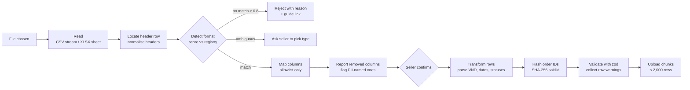

# 04 — Ingestion and parser design

An export file is read, fingerprinted, mapped and stripped inside a Web Worker on the seller's device. Only canonical, validated rows are sent, in chunks. Parsers are versioned plugins in a registry, so a Shopee format change means adding `@v2` rather than editing `@v1`. Until real seller files arrive (Q-D1), every column map below is **assumed** and the parser is built and tested against synthetic files generated from those assumptions.

## Pipeline



## Parser plugin contract

```ts
// packages/parsers/src/types.ts
export interface ExportParser {
  id: `${string}@v${number}`;               // 'shopee.orders@v1'
  exportType: ExportType;                   // 'shopee.orders' | 'shopee.income' | ...
  status: 'assumed' | 'verified';           // 'verified' only after real samples pass
  sheetHint?: RegExp;                       // XLSX sheet name match
  headerRowSearch: number;                  // scan first N rows for the header
  columns: ColumnSpec[];                    // the allowlist
  detect(headers: NormalisedHeader[]): number;  // 0..1 confidence
  toCanonical(row: RawRow, ctx: ParseCtx): CanonicalRecord[] | RowError;
}

export interface ColumnSpec {
  key: string;                              // canonical field
  aliases: string[];                        // normalised header variants (vi + en)
  required: boolean;
  parse: 'text' | 'vnd' | 'int' | 'date' | 'datetime' | 'status' | 'order_id';
}
```

Rules:

- **Allowlist, not denylist.** Any header not matched by a `ColumnSpec` is dropped before transformation and listed to the seller as removed (FR-04). PII never needs to be "detected" to be excluded, because it is excluded by default.
- **PII name list for reporting and defence in depth.** `pii-headers.ts` lists known buyer-field names (for example `tên người nhận`, `số điện thoại`, `địa chỉ nhận hàng`, `người mua`, `email`, `username (buyer)`). If any of these ever appears inside a parser's `columns`, a unit test fails the build. In the removed-columns preview, these are shown under "Thông tin người mua đã được loại bỏ" so the seller sees the protection working.
- **Order IDs** use `parse: 'order_id'`, which hashes in the worker: `hex(SHA-256(shop_salt ‖ utf8(order_id)))` via WebCrypto. The salt comes from the `POST /uploads` response and is the same for every upload of a shop, so hashes join across files (orders ↔ income). A raw order ID never enters a `CanonicalRecord`; its type is `OrderHash`, a branded string.
- **Header normalisation:** NFC → lowercase → strip Vietnamese diacritics (keeping `đ`→`d`) → collapse whitespace and punctuation. Matching uses normalised aliases, so `Mã đơn hàng`, `Ma don hang` and `MÃ ĐƠN HÀNG` all match.
- **Detection score:** `(matched required / total required) × 0.8 + (matched optional / total optional) × 0.2`. Accept at ≥ 0.8 with a margin of 0.15 over the runner-up. Otherwise ask the seller which export it is, or reject.
- **Parsing values:** VND accepts `189.000`, `189,000`, `189000`, `₫189.000`, and `189.000 ₫` → `189000n`. Dates accept `dd/MM/yyyy`, `yyyy-MM-dd`, `dd-MM-yyyy HH:mm`, and Excel serial numbers. Timestamps are interpreted as `Asia/Ho_Chi_Minh`.
- **Status normalisation:** a per-parser map from Vietnamese status strings to `completed | cancelled | returned | in_progress`. An unknown status gives a row warning and the row is kept as `in_progress`, which excludes it from revenue.

## Export types (assumed — replace with real samples)

The names and columns below come from memory of the Seller Centre UI and are **not verified**. They exist so the framework, fixtures and synthetic generator can be built now. Each parser stays `status: 'assumed'` until at least 3 real, anonymised design-partner files pass it.

| Export type | Where in Seller Centre (assumed) | Feeds | MVP? |
| --- | --- | --- | --- |
| `shopee.orders` | Đơn hàng → Xuất | `sku`, `order_line` | Must |
| `shopee.income` | Tài chính → Doanh thu → báo cáo thu nhập | `fee_line` | Must (true profit depends on it) |
| `shopee.product_performance` | Phân tích bán hàng → Sản phẩm | `product_traffic` | Should (unlocks conversion rules) |
| `shopee.mass_update` | Sản phẩm → Công cụ xử lý hàng loạt → Thông tin bán hàng | `sku`, `stock_snapshot` | Should (unlocks stock rules) |
| `seller.unit_costs` | Our own template (FR-05) | `unit_cost` | Must |
| `seller.stock` | Our own template, fallback if no mass-update export | `stock_snapshot` | Must |

### `shopee.orders@v1` assumed allowlist

| Canonical key | Example aliases (normalised) | Parse | Required |
| --- | --- | --- | --- |
| `order_id` → `order_hash` | `ma don hang` | order_id | yes |
| `order_status` | `trang thai don hang` | status | yes |
| `ordered_at` | `ngay dat hang` | datetime | yes |
| `completed_at` | `thoi gian hoan thanh don hang` | datetime | no |
| `item_name` | `ten san pham` | text | yes |
| `variation` | `ten phan loai hang` | text | no |
| `seller_sku` | `sku phan loai hang`, `sku san pham` | text | no |
| `list_price` | `gia goc` | vnd | yes |
| `deal_price` | `gia uu dai` | vnd | yes |
| `quantity` | `so luong` | int | yes |
| `seller_voucher` | `ma giam gia cua shop` | vnd | no |
| `platform_voucher` | `ma giam gia cua shopee` | vnd | no |
| `fixed_fee`, `service_fee`, `payment_fee` | `phi co dinh`, `phi dich vu`, `phi thanh toan` | vnd | no |

Everything else is dropped, including recipient name, phone, address, province, buyer username, buyer note and tracking number. Province might be useful for regional insight later. It stays dropped until a privacy review approves it as non-identifying at province level.

### Unit-cost template (`seller.unit_costs@v1`, ours)

Generated per shop from known SKUs, with a Vietnamese header row and an instruction row:

| `sku_key` (locked) | `ten_san_pham` (locked) | `gia_von` (₫) | `bao_bi` (₫) | `ap_dung_tu` (dd/MM/yyyy) |

`sku_key` is our stable key (`platform_item_id:platform_model_id` or `seller_sku`). Blank costs are allowed: those SKUs are flagged and excluded from margin rankings (US-03).

## Upload API

| Endpoint | Purpose | Limits |
| --- | --- | --- |
| `POST /api/ingest/uploads` | Create the upload (`export_type`, `parser_id`, `file_sha256`, `file_name`, `removed_columns`, `period`). Returns `upload_id` + `salt` | 1 active upload per shop at a time; duplicate `file_sha256` → 409 with a link to the existing upload |
| `POST /api/ingest/uploads/:id/chunks` | `{ seq, records: CanonicalRecord[] }` | ≤ 2,000 records, < 1 MB; idempotent on `seq` |
| `POST /api/ingest/uploads/:id/complete` | Merge, mark `parsed`, enqueue metric recompute | Must have all `seq` 0..n |
| `DELETE /api/ingest/uploads/:id` | Abort | — |

On every chunk the server re-validates with the same zod schema (`strict()`, so unknown keys are rejected). As a final net it scans string fields for phone-number and email patterns. A hit rejects the chunk with `PII_SUSPECTED`, logs the event (without the value), and the UI tells the seller to contact support. That situation means a parser bug, and it must be impossible in normal use.

## Synthetic data and fixtures

- `packages/parsers/synthetic/` generates a 12-month demo shop: ~180 SKUs in home and living, seasonality (Tết, 9.9, 11.11, 12.12 campaigns), a May 2026 fee change, realistic returns and cancellations, and some SKUs with no cost. It is seeded and deterministic.
- The same generator writes **files in each assumed export format**, including fake buyer columns filled with obviously fake values (`Nguyễn Văn Mẫu`, `0900000000`). Tests prove those columns never survive.
- `packages/parsers/fixtures/<parser_id>/` holds small hand-made edge-case files: title rows above the header, merged cells, Excel serial dates, `₫` in numbers, empty trailing rows, a Unicode NFD header, a 25 MB stress file (generated at test time, not committed).
- Real samples from design partners go in `samples/` (git-ignored). A script anonymises them by dropping non-allowlisted columns and re-hashing IDs, then promotes them to fixtures. Only then does a parser move from `assumed` to `verified`.

## Changing formats (risk R2)

1. Unknown headers on a known type (score 0.8–0.95 with unmapped headers) → accept, record `warnings.unmapped_headers`, and alert the operator. This is a heads-up that Shopee changed something.
2. Score < 0.8 → reject with a clear message. The operator adds `shopee.orders@v2` beside v1, and both stay in the registry.
3. A new parser version ships with fixtures from at least one real file and passes the full golden set.

## Performance

- CSV: stream with Papa Parse in the worker (`step` callback), never holding the full text plus the rows twice.
- XLSX: SheetJS reads into memory once. Cap files at 25 MB and warn above 15 MB that CSV export is faster. Note: install SheetJS from its official CDN tarball as its docs instruct; the npm registry copy is outdated.
- Two chunks in flight; retry with backoff; resume from the last acknowledged `seq` if the tab reloads (state kept in IndexedDB, holding only canonical hashed records, never raw rows).
